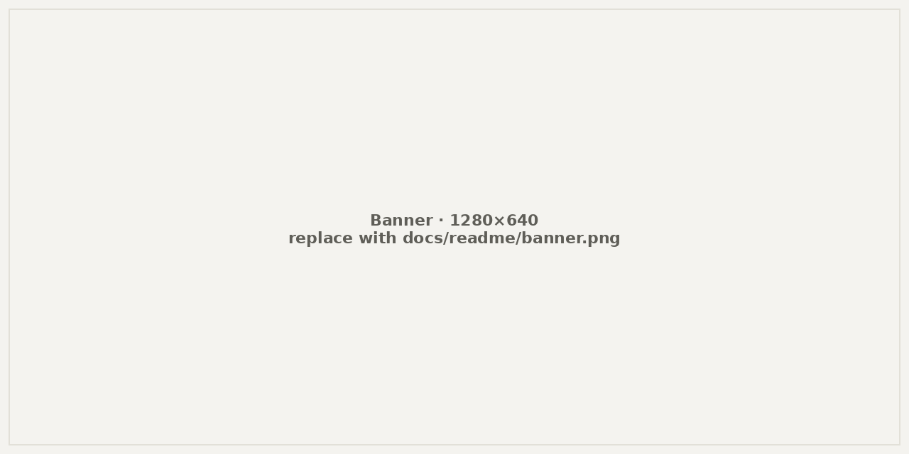
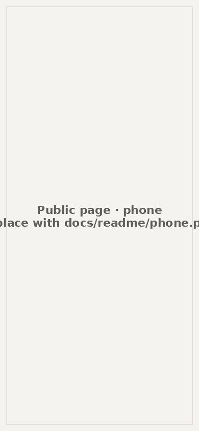
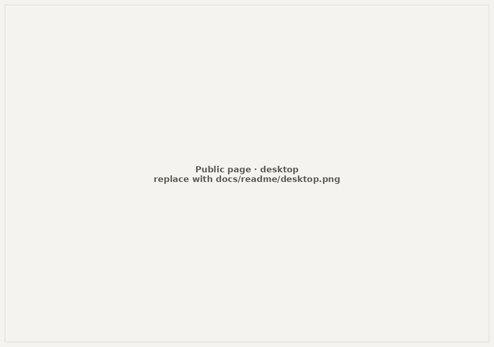
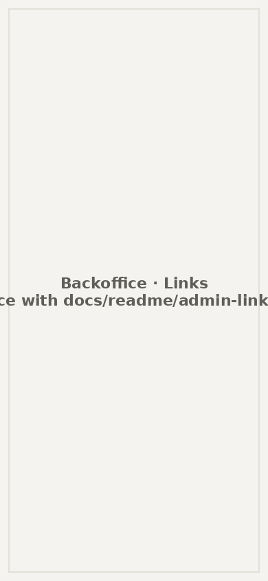
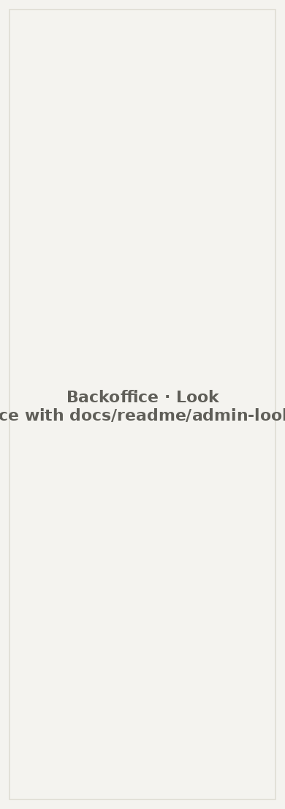

# linkme



A self-hosted **link-in-bio page** with a **phone-first backoffice**. One owner, one page, no vendor, no plan limits. Runs on Vercel + Supabase in production and on an embedded Postgres on your laptop with a single command.

Reference deployment: [links.joaotnlima.pt](https://links.joaotnlima.pt).

<p align="center">
  &nbsp;&nbsp;
  
</p>

<p align="center">
  
</p>

## What you get

**Public page**
- Two layouts, switchable in the backoffice: **Editorial** (your photo, a one-line headline, one primary button) and **Classic** (centered avatar and list).
- Links grouped by section label; social links as an icon row; a copy-link button on every card (slides in on hover, always visible on touch).
- **Feeds** under the links: paste post URLs (LinkedIn, Medium, anything) and the server fetches the OpenGraph title, image and date; Instagram can sync automatically with a Creator/Business account. Cards or a 3-column image grid.
- Light/dark by the visitor's local time (dark 19:00–07:00) with a manual toggle that persists.
- A **share card**: QR code of the page, copy link, native share sheet — for showing your phone to someone.
- A decorative "forking paths" background that respects `prefers-reduced-motion`.
- `/go/<slug>` short links with first-party click counting (no cookies, no third-party analytics).

**Backoffice (`/admin`)**

<p align="center">
  &nbsp;
  &nbsp;
  
</p>

- Links: add, edit, reorder, enable/disable, section labels, display mode (card / featured / icon), emoji override for the icon, custom slug.
- Look: photo, name, bio, headline, quote, layout, primary button, feeds and posts.
- Stats: clicks per day and per link for 7 / 30 / 90 days.
- Settings: configuration overview and a bookmarklet.
- `POST /api/ingest`: add a post from your phone's share sheet, a bookmarklet, or n8n.

**Backend**
- Next.js (App Router, Server Actions, ISR), Drizzle ORM, Postgres.
- Supabase for Postgres, Auth (GitHub, single allow-listed account) and Storage. Everything lives in its own Postgres schema (`links`), so it is never exposed through Supabase's REST API.
- Local mode: [PGlite](https://pglite.dev) embedded Postgres, uploads on disk, admin open — zero accounts needed to try it.

## Quick start (local, no accounts)

```sh
git clone https://github.com/<you>/linkme && cd linkme
npm install
npm run dev
```

Open http://localhost:3000 (page) and http://localhost:3000/admin (backoffice). The first run migrates and seeds a starter profile into `.data/`. Edit everything in `/admin`.

Reset local data: `rm -rf .data public/uploads`.

> PGlite is single-process: don't run `npm run db:migrate` / `db:seed` while `next dev` is running in local mode.

## Deploy (Supabase + Vercel)

1. **Supabase project.** Project settings → Database → copy the **Transaction pooler** connection string (port 6543) → `DATABASE_URL`. Project settings → API Keys → `NEXT_PUBLIC_SUPABASE_URL`, `NEXT_PUBLIC_SUPABASE_PUBLISHABLE_KEY` (sb_publishable_…) and `SUPABASE_SECRET_KEY` (sb_secret_…, server-only). The legacy `anon` / `service_role` names are accepted too.
2. **GitHub login.** Authentication → Providers → GitHub: enable with a GitHub OAuth app whose callback is `https://<project-ref>.supabase.co/auth/v1/callback`. Add `https://<your-domain>/auth/callback` (and `http://localhost:3000/auth/callback` for local testing) to Authentication → URL configuration → Redirect URLs.
3. **Owner.** `OWNER_GITHUB_ID` = your numeric GitHub id (`https://api.github.com/users/<login>` → `id`). Only that account can open `/admin`.
4. **Migrate.** With `DATABASE_URL` set: `npm run db:migrate` (creates schema `links`), optionally `npm run db:seed`.
5. **Vercel.** Import the repo, add the same variables plus `NEXT_PUBLIC_SITE_URL=https://<your-domain>`, deploy. Storage bucket `links-public` is created on first upload.
6. **DNS.** On Cloudflare: `CNAME <sub> → cname.vercel-dns.com`, **DNS only (grey cloud)**; then add the domain in the Vercel project.

All variables are documented in [`.env.example`](.env.example).

## Add posts from anywhere

Set `INGEST_TOKEN` (`openssl rand -hex 24`). Then:

```sh
curl -X POST "https://<your-domain>/api/ingest" \
  -H "Authorization: Bearer $INGEST_TOKEN" -H "content-type: application/json" \
  -d '{"url":"https://www.linkedin.com/posts/..."}'
```

The post lands in the feed whose title mentions the platform (e.g. "Latest on LinkedIn"), otherwise the first enabled manual feed. Duplicates are skipped. Plain-text bodies work too (share sheets send those).

- **iOS**: Shortcuts → new shortcut → *Show in Share Sheet* (URLs, Text) → *Get URLs from Input* → *Get Contents of URL* (POST, JSON `{url}`, URL `…/api/ingest?token=<INGEST_TOKEN>`) → *Show Notification*. Then: LinkedIn post → ⋯ → Share via → your shortcut.
- **Android**: the "HTTP Shortcuts" app can be a share target with the same request.
- **Desktop**: Settings in the backoffice shows a bookmarklet ("+ Add to links").
- **n8n / scripts**: an HTTP Request node to the same endpoint.

**Why not automatic for LinkedIn?** LinkedIn's `r_member_social` permission (read your own posts) is closed to new applicants; only *writing* to your profile is self-serve. Scraping violates their terms. So the share sheet is the honest "one tap" path. Instagram does sync automatically with a Creator/Business account and a Graph API token in `INSTAGRAM_ACCESS_TOKEN`.

## How it works

```
app/
  page.tsx            public page — ISR (60 s), purged on every admin write
  card/               stand-alone share card (QR)
  go/[slug]/route.ts  302 redirect + click insert
  admin/**            backoffice (owner only)
  api/ingest/         token-authenticated post intake
  auth/**             Supabase OAuth callback / sign-out
components/public/    page layouts, background, share card, client islands
components/admin/     forms (Server Actions via useActionState)
lib/
  db/schema.ts        Drizzle schema in pgSchema("links")
  db/index.ts         PGlite locally, postgres-js on Supabase
  actions.ts          every write; each ends with revalidatePath("/")
  queries.ts          reads; stats bucketed in Europe/Lisbon (change TZ there)
  fetchers.ts         site icons, OpenGraph, Instagram Graph; SSRF/size limits apply
  storage.ts          public/uploads locally, Supabase Storage in production
  auth.ts             owner check (GitHub numeric id)
drizzle/              SQL migrations (drizzle-kit)
scripts/seed.ts       starter content
```

Design decisions and their reasons are in [`BULLETPROOF.md`](BULLETPROOF.md) (what's hardened, what's not yet) and in the design review that produced this architecture (one owner, Server Actions over REST, no slug cache, inline click insert, images always copied into own storage).

## Scripts

| Command | What |
|---|---|
| `npm run dev` | migrate + seed (if empty) + dev server |
| `npm run build` / `start` | production |
| `npm run db:generate` | new migration from schema changes |
| `npm run db:migrate` | apply migrations to `DATABASE_URL` or the local store |
| `npm run db:seed` | starter content (skips if links exist) |
| `npm run typecheck` / `lint` | checks |

## Contributing

Issues and PRs welcome. Keep the scope: one owner, one page. Multi-tenant is out of scope by design. Before a PR: `npm run typecheck && npm run lint && npm run build`.

## License

[MIT with an attribution requirement](LICENSE): do what you want with the code, but every public deployment keeps the small "made by joaotnlima" link in the footer (the `MadeBy` component — restyle it, don't remove it). The text above the link is yours to customise in the backoffice. Because of clause 2 this is not the OSI-approved MIT license; if that matters to you, open an issue.
